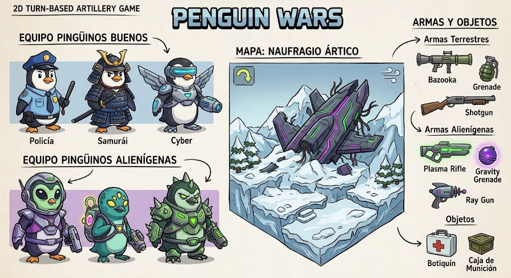

# 🐧 Penguin Wars

A turn-based 2D artillery game inspired by **Worms**, built from scratch in **C#** with **MonoGame**.

Two teams of penguins face off on a snowy battlefield: the **Earth Penguins** defending their home, and the **Alien Penguins** whose spaceship crash-landed on the ice. The player picks a side, and a **hybrid AI** (a local LLM strategist plus a classic simulation-based planner) controls the opposing team.

> **Status:** Work in progress (Phase 8.5 of 9 completed). This is a personal learning project focused on C#, game architecture, game physics and game AI.

---



## Lore

An alien spaceship has crashed in the middle of a frozen wasteland. Its crew, a squad of alien penguins with strange technology, is not here in peace. Three Earth penguins stand in their way: a police officer, a samurai and a cyber penguin. The wreckage of the ship is scattered across the battlefield, and only one team will leave the ice standing.

## Teams

| Earth Penguins (Heroes) | Alien Penguins |
|---|---|
| 👮 Police | 👽 Commander |
| 🗡️ Samurai | 👽 Scout |
| 🤖 Cyber | 👽 Brute |

Each team has **3 members**. Earth penguins use earthly weapons, while alien penguins use alien technology.

## Weapons

| Weapon | Team | Behavior | Starting ammo |
|---|---|---|---|
| Bazooka | Earth | Explodes on impact, strongly affected by wind | Unlimited |
| Grenade | Earth | Bounces and explodes after 3 seconds, not affected by wind | 3 |
| Shotgun | Earth | Straight instant shot, no charging | 2 |
| Plasma Rifle | Alien | Fast, falls less, nearly immune to wind | Unlimited |
| Gravity Grenade | Alien | Bounces, explodes after 3 seconds and **pulls** penguins in | 3 |
| Ray Gun | Alien | Straight instant beam, no charging | 2 |

## Items

| Item | Effect |
|---|---|
| Medkit | Stored in the team inventory. Using it heals the active penguin by 40 HP and ends the turn. |
| Ammo Crate | Gives +2 ammo to a random limited weapon of the team that picks it up. |

## Map

**Arctic Wreck:** a frozen landscape with the remains of the crashed alien spaceship in its central valley.

## Gameplay

- **Single player against the AI:** choose your team, the AI difficulty and whether the LLM strategist is enabled in the main menu.
- **Turn-based:** on each turn, one member of the active team can move and act, with a **45-second** time limit.
- A turn ends when the active penguin **fires a weapon, uses a medkit, passes or runs out of time**.
- Each team **rotates through its living members** every turn, and the starting team is chosen at random.
- **Destructible terrain:** explosions carve the snowy landscape.
- **Projectile physics:** shots are affected by angle, power, gravity and wind, which **changes every turn**.
- **Health bars** for every penguin, plus fall damage and drowning in icy water.
- **Items** spawn on the map, can be picked up by touching them, and sometimes fall from the sky as **supply drops**.
- **AI penguins talk:** with the LLM strategist enabled, they taunt you in character through speech bubbles.
- The match ends when **all members of a team are eliminated** or the player **surrenders**. If both teams are eliminated at the same time, it is a **draw**.

## Development Progress

| Phase | Description | Status |
|---|---|---|
| 1 | Project setup | ✅ Done |
| 2 | Game structure: screens, input and menu | ✅ Done |
| 3 | Destructible terrain | ✅ Done |
| 4 | Penguins: movement, physics and health | ✅ Done |
| 5 | Weapons, projectiles, wind and explosions | ✅ Done |
| 6 | Turn system, teams and win/surrender conditions | ✅ Done |
| 7 | Items: medkits, ammo crates and weapon sets | ✅ Done |
| 8 | Classic AI opponent (shot simulation) | ✅ Done |
| 8.5 | LLM strategist layer with a local model (Ollama) | ✅ Done |
| 9 | Art, sound, map wreckage and polish | 🚧 Next |

### ✅ Phase 1: Project setup
- MonoGame DesktopGL project created with the .NET CLI.
- Git repository and .NET `.gitignore`.

### ✅ Phase 2: Game structure
- `ScreenManager` with an abstract `Screen` class (state pattern) to switch between screens.
- `InputManager` that tracks the current and previous frame to detect *held* vs *just pressed* keys.
- Main menu with team selection (Earth or Alien penguins).
- Custom sprite font with support for Spanish characters.

### ✅ Phase 3: Destructible terrain
- Pixel-based terrain stored as a color array: every pixel is either solid or air.
- Procedural generation by layering sine waves with random phases, using a seed.
- Central valley reserved for the spaceship wreckage.
- Depth-based coloring: snow on the surface, light ice and deep ice below.
- Circular explosions that carve craters and scorch their borders.
- Texture updates only when the terrain changes (dirty flag pattern).

### ✅ Phase 4: Penguins
- Six penguins (3 per team) spawned on opposite sides of the map.
- Pixel-perfect collisions against the terrain mask.
- Walking with automatic climbing of small steps and snapping to slopes.
- Jumping, gravity and airborne movement with sub-pixel accumulation.
- Fall damage, drowning when falling off the map, and tombstones.
- Explosion damage and knockback based on distance.
- Health bars, names and team colors above each penguin.

### ✅ Phase 5: Weapons
- Mouse aiming: the penguin faces the cursor and an aim line shows the shot direction.
- Charged shots: holding the left button fills the power; releasing it fires, and reaching full power fires automatically.
- Projectiles with parabolic trajectories using Euler integration, affected by gravity and wind.
- Sub-stepping (pixel-by-pixel movement) to prevent fast projectiles from tunneling through terrain.
- Random wind with an on-screen indicator.
- Explosions that carve the terrain, damage and knock back penguins, with a fading flash effect.
- Data-driven weapons: each weapon only defines values, so new weapons need no new logic.
- One projectile at a time: movement and actions are locked while a shot is in flight.

### ✅ Phase 6: Turn system
- `TurnManager` implemented as a finite state machine with three phases per turn: **Starting** (turn notice), **Playing** (move, aim, fire) and **Resolving** (waits until projectiles, explosions and falling penguins settle).
- Teams alternate turns, and each team rotates through its living members, skipping eliminated ones.
- Random starting team and new wind every turn.
- 45-second turn timer, shown in red during the last 10 seconds.
- Turn ends on firing, passing, timeout or the active penguin's death.
- Pause menu with **Resume**, **Surrender** and **Exit to menu**.
- Game over screen with **Victory**, **Defeat** or **Draw**, the reason for the ending and a **Rematch** option.

### ✅ Phase 7: Items and weapon sets
- Full arsenals: Bazooka, Grenade and Shotgun for Earth penguins; Plasma Rifle, Gravity Grenade and Ray Gun for Alien penguins.
- Weapons defined with C# `init` properties, so each one only sets the values that differ from the defaults.
- Timed grenades that bounce off the terrain, lose energy, come to rest and show a fuse countdown.
- Gravity Grenade with negative knockback that pulls penguins towards the explosion.
- Instant straight-shot weapons (Shotgun and Ray Gun) with no gravity and no charging.
- Per-team inventory (`TeamInventory`) with limited ammo, weapon selection and medkits.
- Medkits and ammo crates placed on the map, picked up on touch, affected by gravity and destroyed by explosions.
- Random supply drops from the sky at the start of some turns.
- Floating texts to confirm pickups and healing.

### ✅ Phase 8: Classic AI opponent
- The team not chosen by the player is fully controlled by the AI.
- **Simulation-based shot planning:** the AI reuses the game's own `Projectile` class to simulate around 2,000 candidate shots (every weapon with ammo, angles every 4° to both sides and 11 power levels) with the real physics, including wind, bounces and terrain collisions.
- **Scoring function:** expected damage to enemies, a bonus for kills, heavy penalties for friendly fire and self-damage, and a small penalty for distance to the closest enemy.
- **Frame-budgeted search:** the planner is a C# iterator (`yield return`) that runs 40 simulations per frame, so the game never freezes while the AI is "thinking".
- **Decision making:** fires the best shot, heals with a medkit when health is low and no kill is possible, or passes when there are no options.
- **Human-like execution:** the AI rotates its aim gradually and charges power like a player would.
- **Difficulty levels** (Easy, Normal, Hard) that add random angle and power error, selectable in the main menu.

### ✅ Phase 8.5: LLM strategist (hybrid AI)
- A local language model running on **Ollama** (default: `qwen2.5:1.5b`) acts as the **strategic "brain"** of the AI team.
- Each AI turn, the game builds a **text snapshot** of the match (health, distances, heights, wind, weapons, ammo and medkits) and a list of **valid options computed by the game** (attack a specific enemy or heal).
- The model answers in **constrained JSON** (`{"choice": ..., "taunt": ...}`) using Ollama's JSON mode.
- **Validation and graceful degradation:** only options that exist in the list are accepted; on timeout (12 s), invalid output or if Ollama is not running, the classic AI decides alone.
- The classic planner remains the **"hands"**: it searches for the best shot **focused on the target chosen by the LLM**.
- **Asynchronous requests** (`async`/`await` with `Task`) polled from the game loop, so the game stays responsive; the request only reads an immutable text snapshot, never the game objects (thread safety).
- **Provider-agnostic design:** the AI depends on an `IStrategyAdvisor` interface, so Ollama could be swapped for a cloud API without touching the AI logic.
- **Model warm-up** at the start of each match, and `keep_alive` to keep the model loaded between turns.
- **In-character taunts** shown in speech bubbles, sanitized to the characters supported by the game font.
- HUD shows who made the decision (LLM or classic AI) and the chosen goal, and the strategist can be toggled in the main menu.

### 🚧 Phase 9: Art, sound and polish (next)
- Sprites for penguins, weapons, items and the spaceship wreckage based on the concept art.
- Sound effects and music.
- Visual polish and final adjustments.

## Game AI

The opposing team is controlled by a **two-layer hybrid AI**, following the same pattern used in modern AI agents: **an LLM plans, deterministic tools execute**.

1. **Strategic layer (LLM):** a small local model receives a text summary of the match and picks one of the valid options computed by the game, plus an in-character line of dialogue.
2. **Tactical layer (classic):** a deterministic planner that simulates candidate shots with the real game physics and picks the one with the best score, prioritizing the target chosen by the LLM. It is precise, fast and free, and it always works as a fallback.

The LLM never controls aiming directly: language models are not good at precise numeric physics, so they only make high-level decisions that are validated before use.

## Tech Stack

- **Language:** C#
- **Framework:** [MonoGame](https://monogame.net/) (DesktopGL)
- **Runtime:** .NET SDK 9 or later
- **Local LLM:** [Ollama](https://ollama.com/) with `qwen2.5:1.5b` (optional)
- **Editor:** Visual Studio Code with C# Dev Kit
- **Version control:** Git & GitHub

## Architecture

The game is built around MonoGame's **game loop** (`Update` for logic, `Draw` for rendering, about 60 times per second):

- **`ScreenManager`:** switches between screens (menu, gameplay, game over) using a state pattern. Each screen inherits from an abstract `Screen` class.
- **`InputManager`:** stores the keyboard and mouse state of the current and previous frames, allowing the game to distinguish between a key being *held*, *just pressed* and *just released*, and to read the mouse wheel.
- **`TurnManager`:** finite state machine that decides whose turn it is, tracks the turn timer and detects when a turn is over.
- **`TeamInventory`:** each team's ammo, selected weapon and medkits.
- **`AiController`:** finite state machine for the AI's turn (**AskingAdvisor**, **Thinking**, **Aiming**, **Charging**, **Done**) that returns actions for the match to execute.
- **`ShotPlanner`:** frame-budgeted search that simulates and scores candidate shots, with an optional priority target.
- **`IStrategyAdvisor` / `OllamaStrategyAdvisor`:** provider-agnostic interface and its Ollama implementation (HTTP + JSON with `HttpClient` and `System.Text.Json`).
- **`StrategyContext`:** immutable text snapshot of the match and the list of valid options sent to the LLM.
- **`Terrain`:** pixel mask for collisions and destruction, rendered as a texture that is only re-uploaded when it changes.
- **`Penguin`:** encapsulates movement, physics, health and rendering of each character.
- **`Item`:** medkits and ammo crates with simple gravity, picked up on contact.
- **`Weapon`:** immutable weapon definitions (data only), separated from the behavior of `Projectile`.
- **`Projectile`:** simulates the flight of a shot, bounces for timed weapons and detects hits. The same class is used for real shots and for the AI's simulations.
- **`Explosion`** and **`FloatingText`:** short-lived visual effects that remove themselves when finished.
- **`Wind`:** random horizontal acceleration applied to projectiles.
- **`GameSettings`:** global settings such as enabling the LLM strategist.
- **Content Pipeline:** fonts, sprites and sounds are processed at build time through `Content.mgcb`.

```
PenguinWars/
├── AI/             # AI controller, shot planner, difficulty and LLM strategist
├── Content/        # Game assets (fonts, sprites, sounds)
├── Combat/         # Weapons, projectiles and explosions
├── Core/           # Engine-level classes (screens, input, teams, settings, floating texts)
├── Entities/       # Penguins, their profiles and map items
├── Gameplay/       # Match rules (turn system, team inventories)
├── Screens/        # Game screens (menu, gameplay, game over)
├── World/          # Destructible terrain and wind
├── docs/           # Concept art and documentation images
├── Game1.cs        # Main game class and game loop
└── Program.cs      # Entry point
```

## Getting Started

### Prerequisites
- [.NET SDK 9 or later](https://dotnet.microsoft.com/download)
- MonoGame templates:
```
  dotnet new install MonoGame.Templates.CSharp
```
- **Optional, for the LLM strategist:** [Ollama](https://ollama.com/) and a small model:
```
  ollama pull qwen2.5:1.5b
```
  Without Ollama, the game automatically uses the classic AI.

### Run the game
```
git clone https://github.com/KingtanaSr/PenguinWars.git
cd PenguinWars
dotnet run
```

### Use a different local model (optional)
```
# PowerShell
$env:PENGUINWARS_OLLAMA_MODEL = "qwen2.5:0.5b"
dotnet run
```

## Controls (current)

| Input | Action |
|---|---|
| ↑ / ↓ | Navigate menus |
| ← / → | Change AI difficulty / toggle LLM strategist (main menu) |
| Enter | Select option |
| A / D | Walk left / right |
| Space | Jump |
| Mouse | Aim |
| Left click | Fire (hold to charge, release to shoot) |
| 1 / 2 / 3 or mouse wheel | Select weapon |
| H | Use a medkit (ends the turn) |
| P | Pass the turn |
| Esc | Pause menu (resume, surrender, exit to menu) |

## Author

**Josué Quintana Serrano**, Computer Engineering student at Tecnológico de Costa Rica (TEC).

- GitHub: [KingtanaSr](https://github.com/KingtanaSr)
- LinkedIn: [Josué Quintana](https://www.linkedin.com/in/josué-quintana-a9520827b)